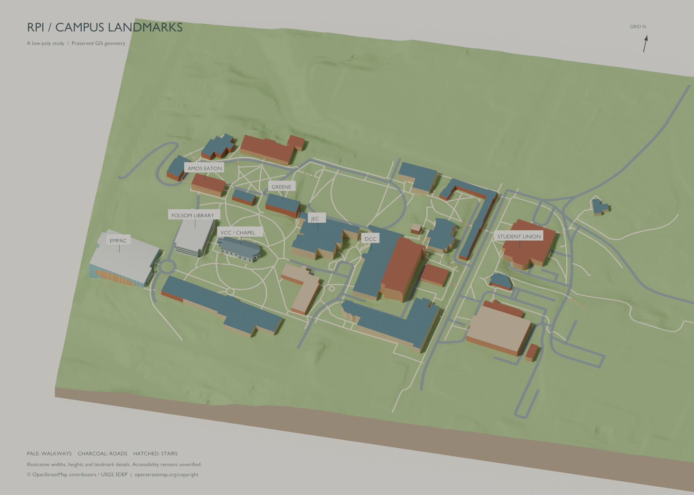
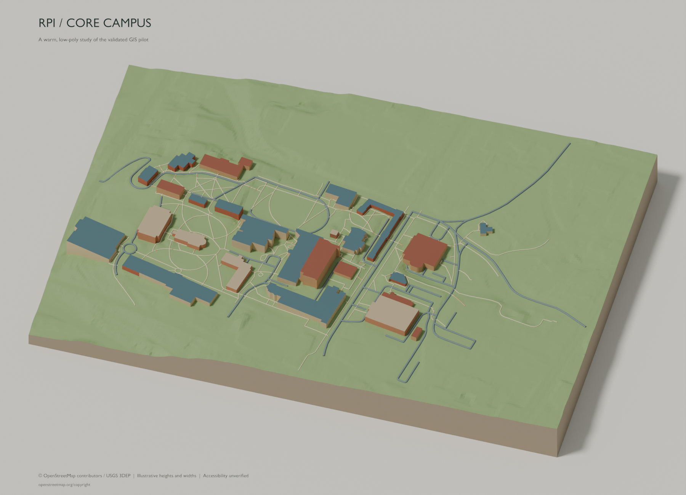

# RPI accessible campus map

Create a geographically accurate, cute low-poly RPI campus map for disability-accessible pathfinding. Read AGENTS.md before working.

## Validated pilot (2026-10-10)

### Latest evidence pass: imagery and elevation

[Evidence review](gis/cleaned/evidence_20261010_01/README.md) · [Imagery overlay](gis/cleaned/evidence_20261010_01/source_overlay.png) · [Integrity checks](gis/cleaned/evidence_20261010_01/integrity_validation.json)

Native 2024 NYS imagery and two USGS LiDAR tiles support eight separate building/pavement review items. No map geometry or Blender files changed. The inspected point clouds have no building-classified returns in the pilot, so roof elevations remain unknown. Source provenance, datum operations and remaining evidence gaps are documented in the review.

### Latest presentation pass: pavement and landmarks

[Open pass 02 Blender file](blender/working/rpi_lowpoly_20261010_pass02_v03.blend) · [Review and limitations](blender/working/rpi_lowpoly_20261010_pass02_REVIEW.md) · [Validation](blender/working/rpi_lowpoly_20261010_pass02_validation.json)

Pass 02 adds 316 flat pavement displays, EMPAC/VCC/Folsom architectural cues, eight building labels and closer framing. All 455 baseline objects are preserved; all 7,747 display centerline stations have zero XY drift. Widths and landmark dimensions remain illustrative. The original pilot and full-extent camera are retained.



### Original pilot

The deterministic GIS pilot and first low-poly styling pass are complete. The setup notes below record the earlier scaffold state; they are historical, not the current pilot status.

- [Final Blender project](blender/working/rpi_lowpoly_20261010_01_final.blend)
- [Styling review, coordinates, limitations and checkpoints](blender/working/rpi_lowpoly_20261010_01_REVIEW.md)
- [Final geometry, topology and metadata validation](blender/working/rpi_lowpoly_20261010_01_final_validation.json)
- [GIS layer validation](gis/cleaned/pilot/validation.json)

All 455 baseline objects passed preservation checks. Source topology, multilevel semantics and unknown accessibility values are retained; NYS comparison data remains separate. Building heights and display path widths are illustrative estimates, not surveyed measurements or verified accessibility guidance. Dedicated pilot scripts implement this work; the original importer and scene-validator placeholders remain untouched.



### Clone with large files

Install Git LFS before cloning, then run `git lfs pull` in the checkout. Blender files and elevation rasters use LFS. Raw source files are stored without line-ending conversion so the integrity seal remains verifiable. Local dependencies and machine-specific runtime state are excluded. Original source licenses and provenance remain alongside the GIS data; bundled third-party add-on licensing is under `setup/`.

```sh
git clone https://github.com/HiddenDevelop/RPI-Low-Poly-Map.git
cd RPI-Low-Poly-Map
git lfs pull
```

## Historical scaffold notes (2026-10-09)

## Project folders

| Folder | Use |
| --- | --- |
| gis/raw/ | Immutable original GIS sources, including all sidecars and provenance |
| gis/cleaned/ | Derived GIS data with CRS, units, transforms, and source lineage |
| gis/accessibility/ | Accessibility attributes, nodes, and verification/uncertainty records |
| blender/master/ | Approved master .blend files; never overwrite |
| blender/working/ | Working copies with new unique filenames |
| blender/checkpoints/ | Recoverable snapshots before major changes |
| scripts/ | Deterministic Blender Python source |
| renders/ | Generated review overviews; ignored by Git |
| exports/ | Generated exports; ignored by Git |
| web/ | Future web source, kept in Git |
| setup/ | Reviewed add-on, license, source pin, dependency record, setup guide |

The six requested Blender scripts are placeholders. They do not import, generate, validate, or save geometry yet. Running import_gis.py only prints a message.

## Current environment (2026-10-09)

- Windows x64, kernel/build 10.0.26200, display version 25H2. The registry reports Windows 10 Home; that legacy product label does not reliably establish current Windows branding.
- Blender 5.2.2 LTS at `C:/Program Files/Blender Foundation/Blender 5.2/blender.exe`; Blender 4.1.0 also installed. Blender is not on PATH.
- Python 3.13.5; uv and uvx 0.6.16; Codex CLI 0.162.0-alpha.17.2; Git 2.53.0.windows.1.
- No running Blender process was found. Live scene inspection and cube test remain pending.
- CIM OS lookup was denied; OS version was obtained through .NET and registry reads.
- Codex CLI emitted sandbox warnings about its temporary PATH aliases but still returned its version and MCP configuration.
- The generated package console launcher failed under the sandbox (script path canonicalization). The project configuration uses the venv Python with the package entry function directly instead.
- The MCP initialization and tool listing succeeded. The scene request returned connection refused (WinError 10061); scene inspection and MCP_TEST creation/removal have not been performed.
- `codex mcp get blender` currently reports no server: the project config is not loaded in this context. Opening/trusting the new project and activation in Codex remain manual steps.
- Codex successfully parsed and displayed the prepared registration when supplied as a transient CLI override (no trust or global configuration edits). See setup/codex-config-verification.txt. The MCP protocol/tool-list probe is recorded in setup/mcp-verification-final.json.
- No initial Git commit was made. Create one with your own configured author identity after reviewing the scaffold.

## Local MCP setup

Installed community `mcp-for-blender` 2.1.9 from commit `7a0373ec9199183cb460068c4f96aed9c579fb4f` into this project's .venv. This is third-party software, not an official Blender Foundation integration.

Prepared project-scoped `.codex/config.toml` with a local STDIO server, Blender endpoint 127.0.0.1:9876, safe mode on, telemetry off, and only inspection/code/visual tools exposed. No public HTTP MCP endpoint is created. Optional external asset/generation tools are excluded. Local runtime files stay under .local/.

See [setup/SETUP.md](setup/SETUP.md) for the remaining manual steps. Project trust is a user decision. No global Codex configuration, Blender preferences, startup file, firewall, execution policy, or filesystem ACL was changed.

## Data protection and repeatability

AGENTS.md supplies the protected-directory and geometry rules. Git tracks source GIS files, important scripts, real .blend files, and the prepared add-on. .gitignore excludes local dependencies, Blender backups, generated renders/exports, caches, and temporary derived GIS files.

These safeguards are workflow rules and version history, not an OS-enforced write barrier. Blender collection names or selection locks cannot prevent Python edits. Keep independent backups of original GIS and approved master files. Do not add ACL deny rules or enable automatic script execution as part of this setup.

Before future edits, capture hashes of raw files and master files, plus protected geometry world transforms and world-space vertices. Compare after work. Preserve unknown accessibility values; absence of stairs is not evidence of wheelchair access. The validator remains a placeholder.

Copy masters into working/ under a new filename. Save a unique checkpoint before major edits. Use explicit CRS/origin/units and deterministic seeds; render an overview after substantial changes. Never use a background Blender run to inspect the user's live scene.

## Next GIS action (after MCP inspection and test pass)

Place your approved source dataset and all companion files into gis/raw/ manually, with provenance, license, acquisition date, and CRS information. Then, from the project folder, start Codex with:

```powershell
codex "Begin the RPI GIS import workflow: first inspect gis/raw read-only and report source files, provenance, CRS, units, extent, and accessibility fields. Do not modify raw files or geometry. Then implement a deterministic scripts/import_gis.py using the reviewed schema, preserving XY and accessibility metadata and saving only to a new file in blender/working with a protected-geometry baseline. Stop if CRS or accessibility semantics are ambiguous."
```

No truthful import command exists yet because no GIS dataset or import implementation has been selected. The command above starts the required review and implementation workflow.
