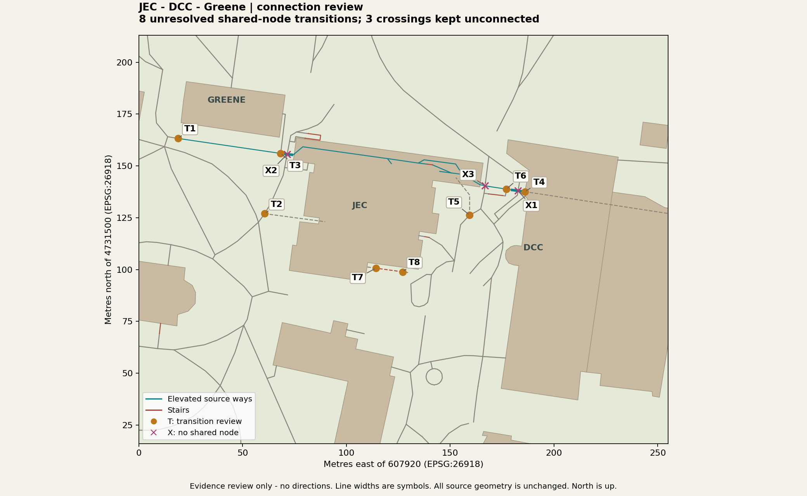

# Bridge connection review

A source-topology review, not an accessible route map. Reviewed 2026-10-11.

## Findings

The historical sheets provide architectural clues but no verified geographic registration or current accessibility status. No plan floor number has been converted to an OSM level or physical height. No datum operations were performed. Original EPSG:26918 coordinates, boundary-crossing features, all ordered source nodes and unknown values remain unchanged.

| Review | Source node / ways | Decision |
| --- | --- | --- |
| T1 | osm/node/1208043799, osm/way/283123280, osm/way/287981183 | Preserve shared source node; do not infer a usable floor transition from layer tags. |
| T2 | osm/node/2032237534, osm/way/192678143, osm/way/192678148 | Preserve shared source node; do not infer a usable floor transition from layer tags. |
| T3 | osm/node/2870374473, osm/way/104737300, osm/way/283123280, osm/way/958903372 | Preserve shared source node; do not infer a usable floor transition from layer tags. |
| T4 | osm/node/2872820222, osm/way/283420316, osm/way/284529300 | Preserve shared source node; do not infer a usable floor transition from layer tags. |
| T5 | osm/node/2872820224, osm/way/1427127624, osm/way/283420318 | Preserve shared source node; do not infer a usable floor transition from layer tags. |
| T6 | osm/node/2882579034, osm/way/283420317, osm/way/284529302 | Preserve shared source node; do not infer a usable floor transition from layer tags. |
| T7 | osm/node/13208046514, osm/way/1437049792, osm/way/1437049793 | Preserve shared source node; do not infer a usable floor transition from layer tags. |
| T8 | osm/node/13208046515, osm/way/1437049793, osm/way/1437049794 | Preserve shared source node; do not infer a usable floor transition from layer tags. |
| X1 | osm/way/104737265, osm/way/284529300 | No connection added. Crossing geometry alone does not establish connectivity. |
| X2 | osm/way/104737300, osm/way/192678148 | No connection added. Crossing geometry alone does not establish connectivity. |
| X3 | osm/way/283420320, osm/way/283420321 | No connection added. Crossing geometry alone does not establish connectivity. |

## Historical plan candidates

* **P1**: Historical JEC 3000 balcony zones 3000B/C/D and open-to-below areas. Review display massing for balcony and undercroft openings after geographic alignment. Sources: [jonssonengctr3000.pdf](../../acquisitions/quacs_floorplans_20261011_01/jonssonengctr3000.pdf).
* **P2**: Historical JEC 3000 and DCC 300 sheets depict vestibules and exterior approaches. Verify bridge endpoints, physical floor correspondence and current closure before model or routing changes. Sources: [jonssonengctr3000.pdf](../../acquisitions/quacs_floorplans_20261011_01/jonssonengctr3000.pdf), [darrin-3.pdf](../../acquisitions/quacs_floorplans_20261011_01/darrin-3.pdf).
* **P3**: Greene 100 sheet depicts vestibule 100F, stair 100E and elevator 1-E near one end. Confirm orientation and actual approach; an elevator symbol does not establish a step-free route. Sources: [jonssonengctr3000.pdf](../../acquisitions/quacs_floorplans_20261011_01/jonssonengctr3000.pdf), [greene-1.pdf](../../acquisitions/quacs_floorplans_20261011_01/greene-1.pdf).

## Current operational evidence

[RPI closure notice](https://administration.rpi.edu/announcements/dcc-jec-upper-deck-walkway-closure) still gives an approximate closure duration, not a confirmed reopening. Its linked official drawings could not be inspected: browser access to RPI Box was denied by permission policy. No alternate access was attempted after that denial.

## Next geometry gate

Before a new Blender checkpoint: establish plan orientation and geographic control matches with residuals; confirm current bridge endpoints, entrances and elevators; distinguish undercroft openings from enclosed areas. Historical symbols alone cannot meet these requirements. No Blender objects were edited in this review.

## Reproduction and validation

`python scripts/build_bridge_connection_review.py --out NEW_DIRECTORY` from the project root (existing GIS Python environment with matplotlib). Output directories must be new. The builder verifies the floor-plan seal, shared-node coordinate identity, unconnected crossings, complete snapshot equality and input byte hashes. Original independent navigation validation also passes: 95 features, 307 ordered segments, 304 incident nodes. This does not constitute route certification.

Sources: OpenStreetMap contributors (original pilot provenance applies); pinned QuACS archive `08c82580638b3e9a3816802f3e1ba98a30383f13` (retained MIT license; original drawing rights uncertain); RPI Administration notice. NYS data remains separate. Source acquisition dates and hashes are retained in the input manifests.
